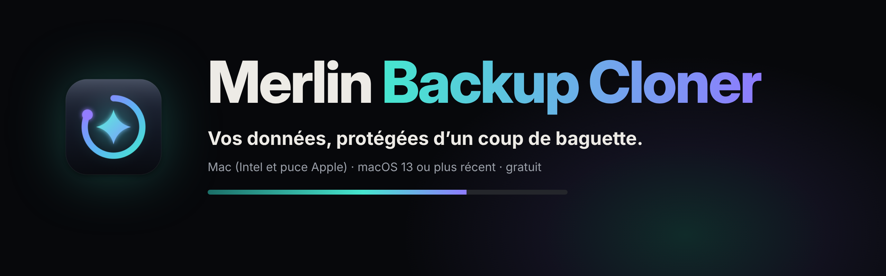
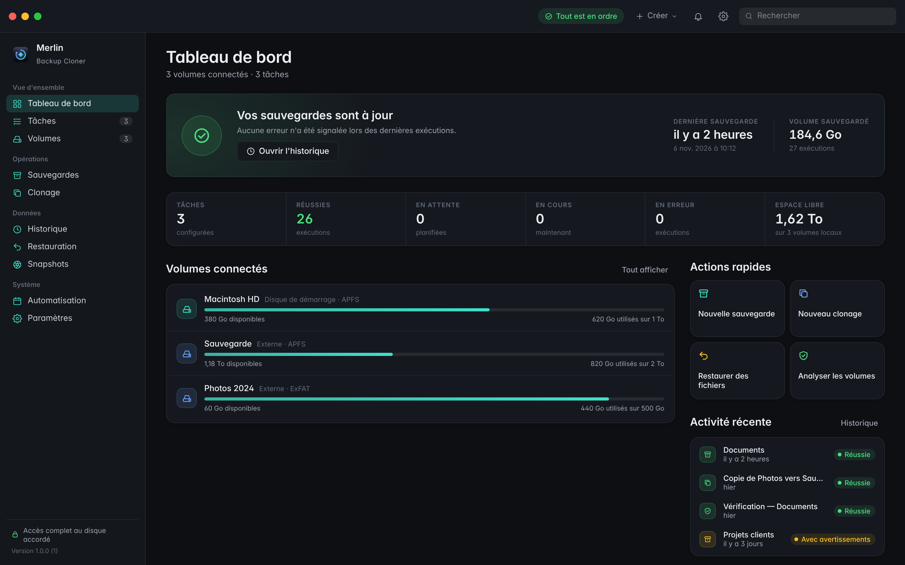
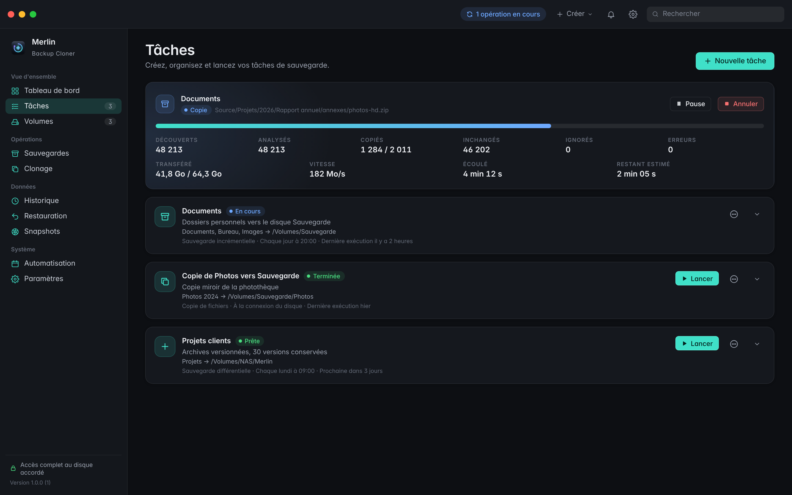
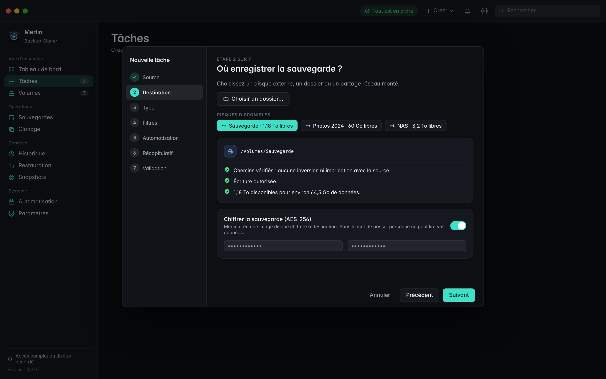
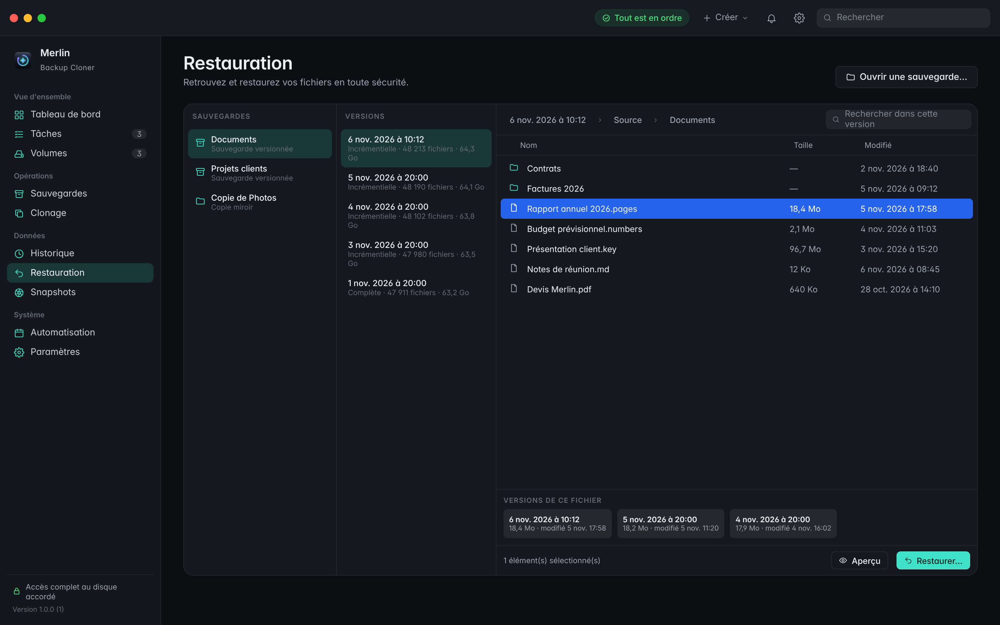
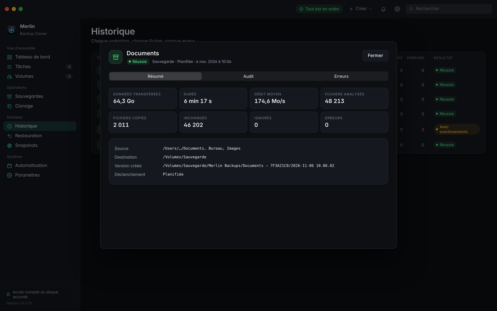
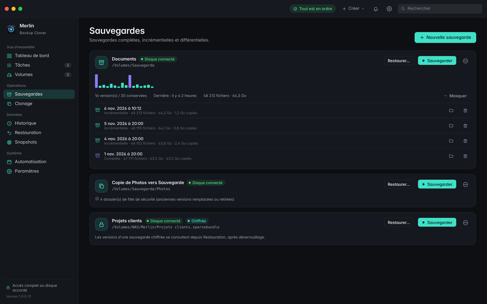
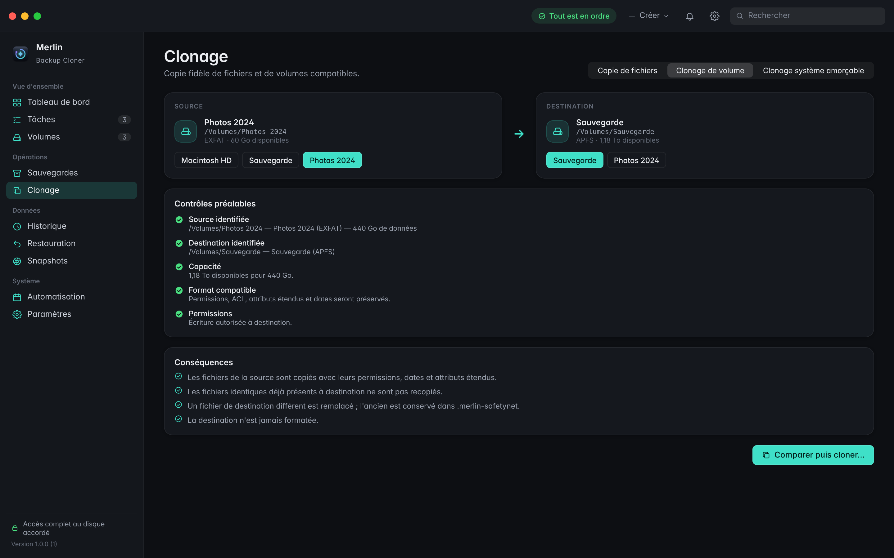

  

  <a href="https://github.com/Merlin-OS/MerlinBackupCloner/raw/main/Merlin-Backup-Cloner-1.0.0.dmg"><b>⬇ Télécharger pour Mac</b></a>
  &nbsp;·&nbsp;
  <a href="https://github.com/Merlin-OS/MerlinBackupCloner/releases">Toutes les versions</a>

---

Merlin Backup Cloner sauvegarde, copie, clone et restaure vos données sur Mac. Choisissez une source et une destination, et Merlin s'occupe du reste : seuls les fichiers modifiés sont copiés, chaque copie est vérifiée, et rien n'est jamais effacé sans votre accord.

- **Sauvegardes versionnées** : complètes, incrémentielles ou différentielles. Chaque version est un dossier daté, consultable dans le Finder ; les fichiers inchangés ne prennent aucune place en plus.
- **Copie et clonage** : copie de dossiers ou clonage d'un disque entier, avec une comparaison avant de lancer. Les fichiers remplacés sont mis de côté, jamais supprimés.
- **Restauration** : parcourez une version, cherchez un fichier, retrouvez ses anciennes versions et restaurez-le sans rien écraser.
- **Automatique** : chaque jour, chaque semaine, chaque mois, ou dès que vous branchez le disque. Une sauvegarde manquée est rattrapée au réveil du Mac.
- **Gratuit** : toutes les fonctions, sans abonnement, sans version payante, sans limite.

## Aperçu

<table>
  <tr>
    <td width="50%"> <b>En direct</b> : fichiers copiés, débit, temps restant, pause et reprise.</td>
    <td width="50%"> <b>Assistant</b> : 7 étapes, espace et permissions vérifiés.</td>
  </tr>
  <tr>
    <td width="50%"> <b>Restauration</b> : versions, recherche, aperçu, sans écrasement.</td>
    <td width="50%"> <b>Historique</b> : chaque opération, chaque fichier, chaque erreur.</td>
  </tr>
  <tr>
    <td width="50%"> <b>Sauvegardes</b> : versions datées, chiffrement AES-256.</td>
    <td width="50%"> <b>Clonage</b> : contrôles préalables, le disque n'est jamais formaté.</td>
  </tr>
</table>

Aperçus de l'interface, avec des données d'exemple.

## Installation

### Mac (macOS 13 Ventura ou plus récent, Intel et puce Apple)

1. Téléchargez [`Merlin-Backup-Cloner-1.0.0.dmg`](https://github.com/Merlin-OS/MerlinBackupCloner/raw/main/Merlin-Backup-Cloner-1.0.0.dmg), ouvrez-le et glissez **Merlin Backup Cloner** dans **Applications**.
2. Au premier lancement, macOS bloque l'app, parce qu'elle n'est pas encore validée par Apple : ouvrez **Réglages Système › Confidentialité et sécurité**, descendez et cliquez sur **Ouvrir quand même**.
3. Pour que Merlin puisse sauvegarder tous vos fichiers (Mail, Messages, Safari…), autorisez-le dans **Réglages Système › Confidentialité et sécurité › Accès complet au disque**. Merlin vous y conduit directement.

## Sécurité et vie privée

- **Rien n'est supprimé sans votre accord** : la source n'est jamais modifiée, aucun disque n'est formaté, et les fichiers remplacés ou retirés sont conservés dans un filet de sécurité.
- **Chaque copie est vérifiée** par une empreinte SHA-256, et l'intégrité d'une sauvegarde peut être revérifiée à tout moment.
- **Chiffrement AES-256** en option, mot de passe rangé dans le trousseau macOS, clé de récupération exportable.
- **Aucune télémétrie** : pas de compte, pas de statistiques, aucune connexion réseau. Tout reste sur votre Mac.

## Limites connues

- Le clonage d'un disque système **démarrable** n'est pas proposé : depuis macOS 11, le système est scellé par Apple.
- Les fichiers appartenant à d'autres comptes du Mac ne sont copiés que si votre compte peut les lire ; les autres sont listés dans l'onglet Erreurs.
- Un disque **NTFS** (Windows) peut servir de source, mais pas de destination sans pilote tiers. Pour un disque partagé Mac et Windows, préférez l'**ExFAT**.

## Version de test

Merlin Backup Cloner 1.0.0 est une première version. Testez-la d'abord sur un disque sans importance. Un bug, une idée ? Ouvrez une [Issue](https://github.com/Merlin-OS/MerlinBackupCloner/issues).
